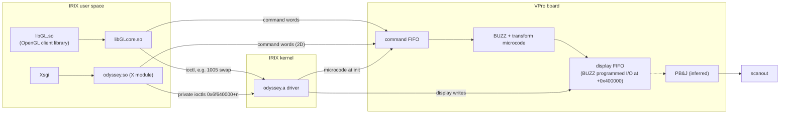

# odsy

Notes on SGI VPro graphics (Odyssey): the V6, V8, V10 and V12 boards in the Octane2 and in IP35 machines like the
Fuel, Tezro and Onyx 350, and the IRIX code that drives them. VPro was SGI's last in-house graphics, and almost
none of it was documented outside SGI.

It's read from IRIX 6.5.30 on a V12 Octane2, with IP35 objects where they've been looked at, plus SGI manuals,
patents and public drivers. Every fact notes where it came from and whether it's established, inferred or still
unknown.

## What's covered

- **BUZZ, the graphics chip:** command words, state blocks, vertex words and the microcode format. Most of its
  internal registers are still unknown.
- **PB&J:** probably the display back end. Display address registers and genlock values.
- **The board:** straps, revision and memory words, display timing, cursor and swap, DMA, the compositor and
  texture.
- **Kernel driver:** `odyssey.a`, read function by function, including its ioctls and the textport.
- **OpenGL, X and IRIS GL:** the GL entry points and the command words they send, and the 2D paths in the X
  module.
- **Microcode:** instruction format, loading and the routine map.

Chip pages are under [devices/](devices/README.md), the IRIX side under [software/](software/README.md).

## How the software reaches the board

<!-- Question: when software draws or swaps buffers, which IRIX component reaches which board interface?
Evidence: devices/buzz/BUZZ.h section 1 and software/opengl/opengl.md (libGLcore and odyssey.so both write
command words); devices/display/README.md "Scanout path" (X module uses only ioctls 0x6f640000+n, display
writes go through BUZZ PIO +0x400000, libGLcore sends ioctl 1005 to swap); software/ucode/buzz_ucode.md
(odsyInitCfifo loads microcode); software/opengl/libraries.md (libGL needs libGLcore); devices/pbj/README.md. -->


## Using it

The headers and the crate live in [generated/](generated/). Don't edit them; they're built from the
`registers.toml` next to each device page.

To run the checks yourself:

```sh
git clone https://github.com/jamesbraid/odsy && cd odsy
tools/setup-clone.sh --root /path/to/your/irix/files
retools/tools/re-run retools/tools/defs/ci-check
```

You'll need Podman, git, python3 and your own IRIX files. [evidence/irix-files.md](evidence/irix-files.md) lists
which ones.

## How far along

The microcode, ioctls and most of the tokens are done. The functions have a long way to go. The open questions are in [questions/](questions/README.md).
If you spot a mistake or have a manual we don't, [open an issue](https://github.com/jamesbraid/odsy/issues).

| Table | Rows | % understood | % located or better |
|---|---:|---:|---:|
| [binaries](evidence/inventory/binaries.tsv) | 276 | 97.1 | 97.1 |
| [functions](evidence/inventory/functions.tsv) | 106592 | 7.2 | 59.6 |
| [mmio](evidence/inventory/mmio.tsv) | 67 | 83.6 | 94.0 |
| [tokens](evidence/inventory/tokens.tsv) | 271 | 84.9 | 93.4 |
| [ioctls](evidence/inventory/ioctls.tsv) | 92 | 95.7 | 96.7 |
| [ucode](evidence/inventory/ucode.tsv) | 247 | 100.0 | 100.0 |

## License

[BSD 3-Clause](LICENSE). The `retools/` scripts started life as gr4's and keep its notice. No SGI binaries in
here; bring your own.

## Credits

James Braid, plus a lot of Claude and Codex reading MIPS disassembly so I didn't have to.

Thanks to -

* Dominik Behr ([@techomancer](https://github.com/techomancer)) for [gr2](https://github.com/techomancer/gr2)
  and [gr4](https://github.com/techomancer/gr4), where the layout and working style come from
* The OpenBSD developers, for their VPro driver
* Everyone keeping SGI manuals, `hinv` dumps and IRIX media online
